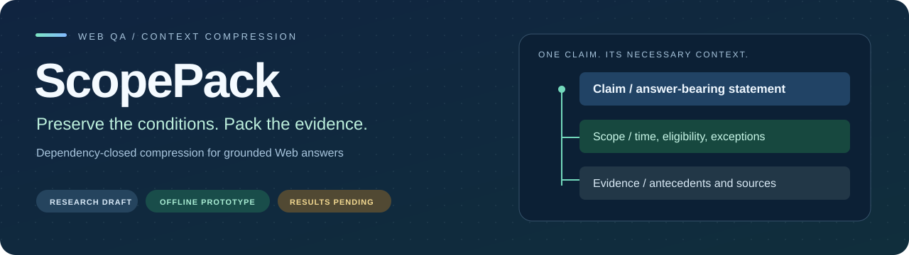
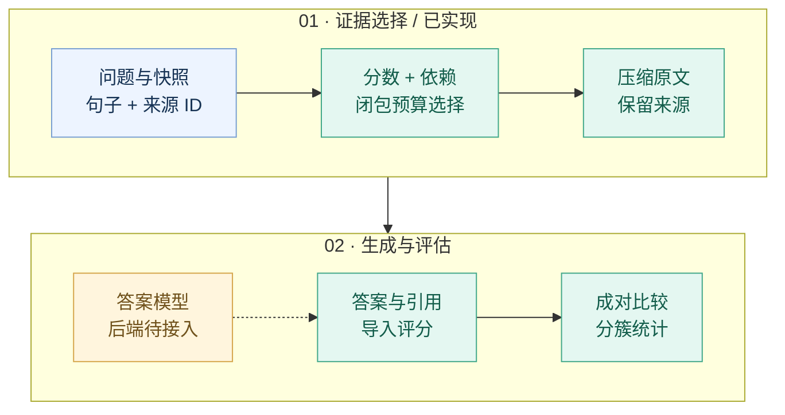

<div align="center">



**面向网页问答的适用条件与证据依赖保留压缩**

*Preserving Applicability under Context Budgets: Dependency-Closed Compression for Web Question Answering*

[论文初稿](www_draft.md) · [研究方案](研究与实验方案.md) · [开始实验](EXPERIMENT_PLAYBOOK.md) · [路线图](ROADMAP.md) · [结果模板](RESULTS_TEMPLATE.md)

</div>

---

> [!IMPORTANT]
> **研究工作稿，真实模型结果待完成。** 当前交付了方法设计、离线原型与统计工具；没有声称优于现有方法。默认样例使用正则计数单元，不能用于模型 token 效率结论。

<table>
<tr><th align="center">验证</th><th align="center">样例</th><th align="center">请求</th><th align="center">阶段</th></tr>
<tr>
<td align="center"><b>13</b><br/>本地测试通过</td>
<td align="center"><b>8</b><br/>软件样例</td>
<td align="center"><b>112</b><br/>待执行请求</td>
<td align="center"><b>准备阶段</b><br/>未运行模型</td>
</tr>
</table>

## 01 · 为什么要保留“适用条件”

网页上的结论往往不是无条件成立的。价格可能只适用于新用户，退款可能排除经销商订单，政策可能在某一天之后才生效。压缩若留下结论、删掉条件，就可能改变证据的含义。

| 原始材料 | 只保留相关句时的风险 | ScopePack 的处理目标 |
|---|---|---|
| “十四天内可退款。”<br/>“仅限直接购买，不含经销商订单。” | 问经销商订单时，只看到第一句可能得出相反答案。 | 将结论及其必要条件作为依赖闭包，共同计入预算。 |

*这是解释机制的虚构例子，不是已测得的真实模型失败案例。*

**核心研究问题：** 固定检索结果、相关性分数、答案模型和上下文预算后，显式依赖约束能否提供超出强上下文剪枝与邻句扩展的收益？

## 02 · 从网页证据到可核对的答案



| 已实现 | 还需验证 / 开发 |
|---|---|
| BM25 分数、英文规则依赖、闭包选择、来源保留 | 学习型依赖预测、真实网页解析和跨页指代 |
| full / none / head / bm25 / neighbors / closure | Provence、LongLLMLingua、LLMLingua-2 等强基线 |
| 预算检查、导入预测评分、缺失结果保留 | 真实 tokenizer 与模型后端、官方 benchmark 指标 |
| 成对差值、cluster bootstrap、Damage / Rescue | 语义引用审查、实际费用与端到端性能 |

> [!NOTE]
> 闭包可行性不等于语义充分性。当前图由规则预测；错误依赖可能遗漏条件或浪费预算。新颖性及真实数据有效性仍需实验证据。

## 03 · 两分钟运行离线流程

**环境：Python 3.10+。** 默认流程只用标准库；在仓库根目录执行：

```bash
# 准备上下文与模型请求，不调用模型
python experiment/prototype.py prepare --data experiment/demo.jsonl --out work/demo_run

# 验证预算、金标隔离、评分和统计约束
python -m unittest discover -s experiment -p "test_*.py" -v
```

生成目录中，`requests.jsonl` 是模型输入，`context_diagnostics.jsonl` 是评测侧诊断，`manifest.json` 记录准备状态。**仅将 requests 中的 messages 交给答案模型。**

<details>
<summary><b>有了真实模型输出后：评分 → 成对统计</b></summary>

先按 [接口约定](experiment/README.md) 接入所选模型，将同次运行的回复保存为 `predictions.jsonl`。推理后端尚未提供；下面的命令不会生成答案，也不能在预测文件缺失时运行。

```bash
python experiment/prototype.py evaluate --data experiment/demo.jsonl --requests work/demo_run/requests.jsonl --predictions work/demo_run/predictions.jsonl --out work/evaluation

python experiment/analyze.py --scores work/evaluation/scores.jsonl --candidate closure --baseline bm25 --budget 128 --resamples 10000 --seed 2026 --out work/analysis_001
```

`128` 仅匹配默认软件样例的正则预算。正式实验须用真实数据、目标 tokenizer 和预先选择的主预算。统计输出为 `paired_analysis.json` 与 `paired_analysis.md`，不会覆盖已有同名报告。

每份 scores 只对应一个数据版本、答案模型、提示配置和生成重复；保留 full 参照及所有预定请求。工具拒绝未成对样本和重复记录，漏回仍计入分母。详情见 [统计说明](experiment/ANALYSIS.md)。

</details>

## 04 · 下一轮实验怎么推进

| 阶段 | 做什么 | 通过条件 |
|---|---|---|
| **A · 联调** | 确定模型 / tokenizer / 后端，先跑 10 条真实请求 | 无金标泄漏、无静默截断，输出与日志可追溯 |
| **B · Pilot** | 收集与独立标注约 150 题，多来源分簇 | 现象在真实数据存在，标注与配对可靠 |
| **C · 机制检验** | 同分数去边、邻句、Provence、oracle 图 | 收益不能由强基线或多留几句完全解释 |
| **D · 正式评估** | 锁定测试集，测质量、统计区间和总成本 | 包含失败案例、未见来源和端到端开销 |
| **E · 成稿** | 根据真实结果改写论文，核验 CFP 与 ACM 模板 | 贡献有证据，投稿规则和匿名要求满足 |

直接开始：[实验操作手册](EXPERIMENT_PLAYBOOK.md) · [运行配置模板](EXPERIMENT_CONFIG.template.json) · [结果记录模板](RESULTS_TEMPLATE.md)

配置模板是实验前填写的记录表，**当前程序不会自动读取它**。未填写项为 `null`，不能当作已完成的配置。

## 05 · 证据状态

| 检查层 | 当前证据 | 结论范围 |
|---|---|---|
| 软件层 | 13 项本地检查通过 | 支持实现约束；不是模型能力分数 |
| 输入层 | 8 个软件样例、112 条待执行请求 | 支持离线数据流检查；不是 Web 数据集 |
| 模型层 | **Pending** | 尚无真实准确率、语义引用分数或质量提升 |
| 效率层 | **Pending** | 尚无真实 token 节省、推理速度或总费用 |

关键是验证：**显式依赖是否带来可归因、可重复且值得付出成本的改进。** 若邻句扩展或强剪枝足以解释收益，应缩小或修改主张。

## 06 · 文档地图

| 你想做什么 | 从这里开始 |
|---|---|
| 和导师讨论问题与方法 | [英文初稿](www_draft.md) · [中文研究方案](研究与实验方案.md) |
| 修改论文排版与公式 | [LaTeX 源码](www_draft.tex) |
| 排查近邻与创新边界 | [文献核对与待办](文献核对与待办.md) |
| 收集数据、标注并联调模型 | [实验操作手册](EXPERIMENT_PLAYBOOK.md) |
| 运行代码与理解数据格式 | [实验 README](experiment/README.md) |
| 分析实测结果 | [统计说明](experiment/ANALYSIS.md) · [结果模板](RESULTS_TEMPLATE.md) |
| 查看已做与未做的事情 | [验证记录](experiment/validation_report.md) · [路线图](ROADMAP.md) |
| 获取最初版本存档 | [初稿压缩包](WWW初稿包.zip)（不含后续更新） |

<details>
<summary><b>目录结构</b></summary>

```text
scopepack-www/
├── README.md                         项目首页
├── scopepack-banner.svg              本地矢量封面
├── www_draft.md / www_draft.tex       论文初稿
├── EXPERIMENT_PLAYBOOK.md             实验操作手册
├── EXPERIMENT_CONFIG.template.json    运行配置记录模板
├── RESULTS_TEMPLATE.md               结果与证据记录模板
├── ROADMAP.md                        阶段任务与退出条件
└── experiment/
    ├── prototype.py                  上下文选择与预测评分
    ├── analyze.py                    成对分析与分簇 bootstrap
    ├── test_prototype.py             实现约束检查
    ├── test_analyze.py               统计约束检查
    ├── demo.jsonl                    软件样例
    ├── ANALYSIS.md                   统计口径说明
    └── demo_run/                     已准备但未执行的请求
```

</details>

---

<div align="center">

**Research first. Evidence before claims.**

研究期间保持私有 · 尚未选择开源许可证 · WWW 届次与 CFP 待核验<br/>
LaTeX 尚未成功编译验证；当前排版不是已核验的 ACM 投稿模板。

</div>
